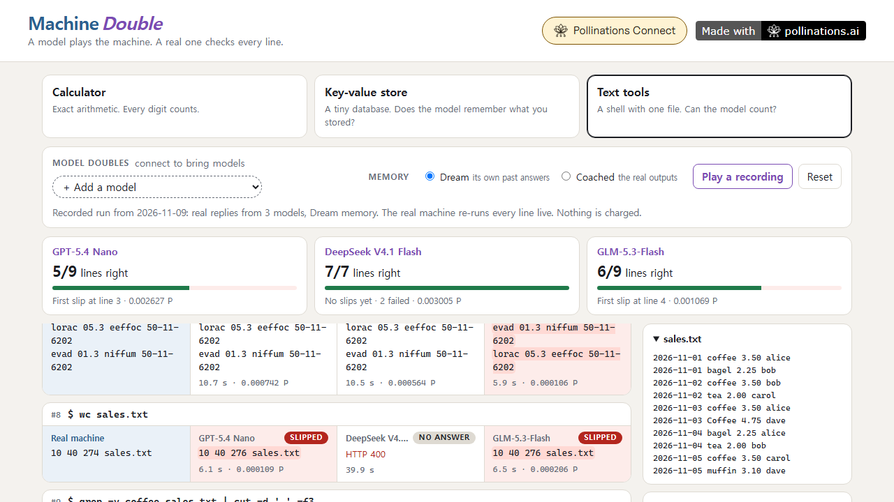

# Machine Double

[](https://pollinations.ai/?ref=badge)

**A model plays the machine. A real one checks every line.**

An AI model pretends to be a calculator, a small key-value database or a shell with text tools. The real machine, written in plain JavaScript in the page, runs every line next to it, so you see the exact line where the model's imitation drifts from the machine it is playing. You pay with your own Pollen (BYOP).

**Live app:** https://patbing.github.io/machine-double/ · Pollinations quest [#19179](https://github.com/pollinations/pollinations/issues/19179)



## The machines

| Machine | The model must... | The real machine is |
|---|---|---|
| **Calculator** | print exact results: `2^64`, `987654321 * 123456789`, `1/7` to 12 digits | exact rational arithmetic on `BigInt` |
| **Key-value store** | remember state across commands: `SET`, `INCR`, `APPEND`, `RENAME`, `KEYS`... | a JavaScript object with redis-style replies |
| **Text tools** | run `grep`, `sort`, `uniq -c`, `wc`, `cut`, `rev` and pipes over one fixed file | small versions of the coreutils, checked against GNU output |

Each model gets the machine's manual (shown in the app under *What the model is told*) and the session so far, and must print only what the machine would print.

## How to play

- Pick a machine, type a line (or a suggestion under **Try**) and press Run.
- Bring up to **three model doubles** side by side. Each line shows the real output, each model's output, and a *same* / *slipped* verdict with the differing lines highlighted. The score cards keep count and show the first slip.
- **Memory: Dream or Coached.** In Dream mode each model sees its own earlier answers, so one wrong `INCR` becomes a different database a few lines later. In Coached mode it sees the real outputs instead, so every line is a fresh test.
- Comparison is line by line after collapsing spaces. The key-value store ignores redis-cli decoration only (`(integer) 42` = `42`), never values.

## Try it without an account

Press **Play a recording** (or open `?machine=text&play=1`). Each machine has a recorded run with real replies from GPT-5.4 Nano, DeepSeek V4.1 Flash and GLM-5.3 Flash, recorded on 2026-11-09. The real machine re-runs every line live during playback, so the verdicts are computed in your browser, not stored. Without signing in you can also type into the real machines directly.

## How Pollinations is used

| Purpose | Endpoint |
|---|---|
| The model doubles | `POST https://gen.pollinations.ai/v1/chat/completions` |
| Model list and per-token prices (for the cost shown on every reply) | `GET https://gen.pollinations.ai/v1/models` |
| Sign-in, BYOP | `<polli-connect>` from `@pollinations/ui` (budget 1 Pollen, 7 days) |

All network code is in [`js/net.js`](js/net.js). The cost of each reply is computed from the response's `usage` and the listed prices. The app shows an estimate for the next line before you run it, because the whole session is resent each time.

## Privacy and safety

- Your `sk_` key comes from Pollinations Connect and stays in the page's memory. The app does not store or log it.
- Model output is only ever inserted as text (`textContent`), never as HTML.
- No backend, no analytics, no build step.

## Run locally

```bash
python -m http.server 8130 --bind 127.0.0.1
```

Open http://127.0.0.1:8130/ (this address is registered on the app key, so sign-in works locally too).

```bash
node --test tests/
```

The tests check the real machines (exact arithmetic, the key-value state, the text tools against GNU coreutils output on the same file) and the judging rules.

To re-record the demo runs with your own key: `POLLINATIONS_KEY=sk_... node tools/record.mjs 0.1` (the argument is a Pollen cap; the last recording cost about 0.015 Pollen).

## License

MIT
